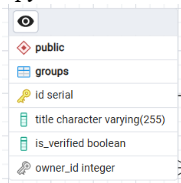
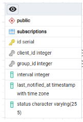

### Группы

Группы - это объединения ссылок  
Например, группа "смартфон VIVO", и линкуется с каким то количеством ссылок  
Группы могут быть глобальные (верифнутые), локальные (приватные, созданные юзером)  
Мотивация понятна - один и тот же товар может быть на нескольких маркетплейсах у разных продавцов.  
Хочется какой-то удобной группировки.

Группы как таблицы БД содержат следующие поля  


Группы как таблицы БД ничего не знают про интервал опроса  
Но через группы задается интервал опроса для всех ссылок, которые группа содержит.  
Это происходит ИЛИ в момент создания новой подписки на группу, ИЛИ в момент изменения этой подписки  
Для каждой ссылки в итоге интервал опроса - это минимальный интервал опроса из всех подписок на те группы, в которых состоит ссылка

То есть, пусть ссылки A, B, C, D лежат в группах 1 и 2, которые пронадлежат юзерам USER1 и USER2  
Пусть USER1 выставил время опроса 1 час, а USER2 - 30 минут  
Тогда ссылки A, B, C, D будут опрашиваться с интервалом в 30 минут  
При этом уведомления пользователям будут приходить в соответствии с выбранным пользователями временем

Возможен и сценарий, когда в одной и той же группе будет опрос с разной частотой  
Например, пусть есть ссылки A B C D E  
A B C лежат в первой группе B C D E лежат во второй  
Интервал для первой группы пусть будет полчаса, для второй - час  
Тогда ссылки B и C ВТОРОЙ группы будут опрашиваться с частотой полчаса, а D и E - 1 час  
Это НЕ считается проблемой.  
Дабы уведомить пользователя, следует вывести рядом ссылкой время, прошедшее с ласт опроса.

Во всех этих случаях ГАРАНТИРУЕТСЯ, что опрос будет происходить ровно каждые N минут или даже раньше (НО НЕ ПОЗЖЕ!).

### Подписки



Подписка - это контракт на получение данных для ссылок определенной группы с ЖЕЛАЕМЫМ интервалом interval  
При изменении статуса подписки и при ее создании интервал будет **просачиваться** во все ссылки этой группы и уменьшаться

При ее удалении должна быть вызвана функция пересчета (потенциальное увеличение интервала опроса) интервала для всех ссылок данной группы  
Это делает `recalculate_links_interval`  
Что она делает:

1. берет все подписки на группу, подписку на которую мы удаляем
2. берет минимальный ожидаемый интервал опроса
3. применяет его ко всем ссылкам группы

Для удаления ссылки из группы НИЧЕ НЕ ПЕРЕСЧИТЫВАЕТСЯ МНЕ ЛЕНЬ это mvp

Данная операция имеет довольно низкий приоритет, ее можно сделать как запрос в какой то буфер (потому что за раз это может быть слишком жестко, например при удалении пользователя будет вызвано каскадное удаление всех записей и тогда сервер может повиснуть, если у юзера было 10000 ссылок суммарно).  
Для MVP этого НЕ ТРЕБУЕТСЯ.

### Планировщик

делегирую кому то

### Известные особенности

Ссылки остаются бесхозными (не удаляются) если последняя группа, которая на них ссылается, удаляется

При удалении ссылки из группы она ведь еще и удаляется из подписки, сейчас пересчет по этому поводу НЕ производится. Производится пересчет только при удалении всей группы

Пересчет интервалов трудоемкая операция, которая может повалить сервак (нужна очередь)

Нельзя создать публичную группу

Нельзя паузить подписку

Маркетплейсы создаются заранее (`create_db`) и не могут быть добавлены рядовым пользователем

Не реализована админ роль

### Как запустить калл

Создайте виртуальное окружение, загрузите все зависимости

```
pip install -r requirements.txt
```

Создай в .env файл по шаблону

```
# Настройки базы данных (совпадают с docker-compose.yml)
DB_USER=user
DB_PASSWORD=password
DB_HOST=localhost
DB_PORT=5433 # можно оставить дефолтный порт 5432 если у вас не залочен он уже
DB_NAME=price_tracker

# Настройки безопасности
SECRET_KEY=сгенерируйте_здесь_любую_длинную_строку_из_букв_и_цифр
ALGORITHM=HS256
ACCESS_TOKEN_EXPIRE_MINUTES=30
```

ЗАпустите докер

```
docker-compose up -d
```

Создайте таблицы через

```
python create_db.py
```

Зайди в /server и запусти его

```
python -m uvicorn app.main:app --reload
```


